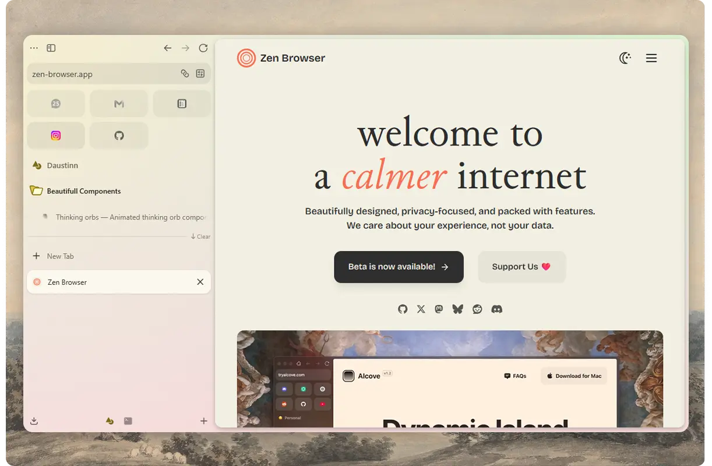

# Zen Macify

A CSS mod for Zen Browser (Windows) that unifies border-radius, tab/toolbar heights, and the essentials grid across the UI — making the Windows version feel closer to the more rounded macOS design.



## Quick Installation

Run this command in PowerShell to automatically detect your Zen Browser profile and append or update the mod in your `zen-themes.css`:

```powershell
irm https://raw.githubusercontent.com/daustinn/zen-macify/main/install.ps1 | iex
```

Or from the cloned repository:

```powershell
.\install.ps1
```

For Bash:

```bash
curl -fsSL https://raw.githubusercontent.com/daustinn/zen-macify/main/install.sh | bash
```

## Manual Installation

> **Note:** The official [Zen Theme Store](https://github.com/zen-browser/theme-store) has been discontinued, so this mod must be applied manually.

1. Open Zen Browser and type `about:profiles` in the address bar.
2. Under your current profile, click **Open Directory** next to the Root Directory.
3. In the profile folder, open the `chrome` folder (create it if it doesn't exist).
4. Copy the `chrome.css` from this repository into the `chrome` folder.
   - *If you already have a `chrome.css` file, copy the contents of this mod into it, or import it.*
5. Restart Zen Browser.
