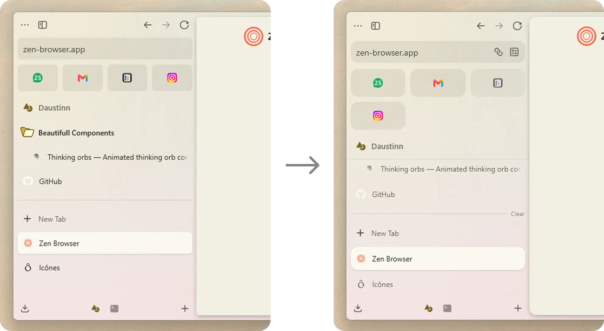

# zen-macify

A CSS mod for Zen Browser (Windows) that unifies border-radius, tab/toolbar heights, and the essentials grid across the UI — making the Windows version feel closer to the more rounded macOS design.

